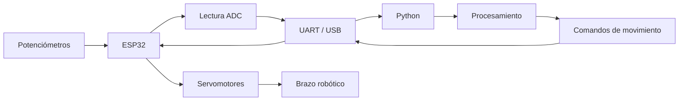
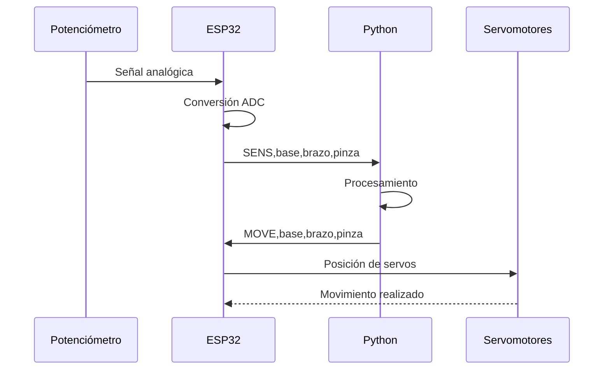

# 🤖 Actividad 5 – Control de un brazo robótico con ESP32 y Python

**Universidad Militar Nueva Granada**  
**Programa:** Ingeniería Mecatrónica  
**Asignatura:** Micros y Laboratorio  
**Autor:** [kevin philip castelblanco ramirez]  
**Código:** [7004607]

---

## 📌 Descripción del proyecto

Este proyecto desarrolla un sistema para el **control de un brazo robótico utilizando una ESP32 y Python**.

La ESP32 se encarga de leer tres señales analógicas provenientes de potenciómetros, utilizadas como sensores de posición. Los datos son enviados al computador mediante comunicación **UART por USB**.

Desde Python se reciben y procesan estos datos y también se pueden enviar comandos hacia la ESP32 para controlar las diferentes articulaciones del brazo y la apertura o cierre de la pinza.

Además, el proyecto incluye un modelo **URDF** que representa de forma simplificada la estructura del brazo robótico.

La arquitectura general del sistema es:

```text
Sensores
   ↓
ESP32
   ↓
UART / USB
   ↓
Python
   ↓
Procesamiento y control
   ↓
Comandos
   ↓
ESP32
   ↓
Servomotores
   ↓
Brazo robótico
```

---

# 📑 Contenido

1. [Arquitectura del sistema](#1-arquitectura-del-sistema)
2. [Funcionamiento](#2-funcionamiento)
3. [Modelo URDF](#3-modelo-urdf)
4. [Comunicación UART](#4-comunicación-uart)
5. [Materiales y software](#5-materiales-y-software)
6. [Conexiones](#6-conexiones)
7. [Paso a paso para ejecutar](#7-paso-a-paso-para-ejecutar)
8. [Explicación del código](#8-explicación-del-código)
9. [Pruebas del sistema](#9-pruebas-del-sistema)
10. [Estructura del repositorio](#10-estructura-del-repositorio)
11. [Problemas comunes](#11-problemas-comunes)
12. [Conclusiones](#12-conclusiones)
13. [Referencias](#13-referencias)

---

# 1. Arquitectura del sistema

## 1.1 Diagrama general

El proyecto se divide principalmente en dos partes.

La **ESP32** realiza la adquisición de las señales analógicas y controla los actuadores.

El **computador** ejecuta el programa desarrollado en Python, encargado de recibir la información y enviar las órdenes de movimiento.



De esta manera se establece una comunicación bidireccional entre el computador y el microcontrolador.

---

## 1.2 Flujo de información

Cuando se mueve uno de los potenciómetros, la ESP32 realiza una lectura utilizando su conversor analógico-digital.

Posteriormente el valor es convertido a una posición angular y enviado mediante comunicación serial.



---

# 2. Funcionamiento

El funcionamiento general del sistema es el siguiente:

1. La ESP32 inicia la comunicación serial a **115200 baudios**.
2. Se realizan las lecturas de los tres potenciómetros.
3. Las lecturas ADC se convierten en valores correspondientes a las articulaciones.
4. Cada **200 ms** la ESP32 envía los valores hacia el computador.
5. Python recibe la información mediante el puerto serial.
6. Los valores recibidos se muestran en tiempo real.
7. El usuario puede enviar nuevas posiciones desde Python.
8. La ESP32 recibe los comandos.
9. Los servomotores son posicionados de acuerdo con los valores recibidos.
10. También se pueden enviar comandos específicos para abrir o cerrar la pinza.

Esto permite comprobar una comunicación **bidireccional ESP32 ↔ computador**.

---

# 3. Modelo URDF

El proyecto incluye el archivo:

```text
urdf/brazo_robot.urdf
```

URDF significa:

**Unified Robot Description Format**

Este formato permite representar la estructura de un robot mediante elementos llamados:

- `links`
- `joints`

Los `links` representan las partes físicas del robot y los `joints` representan las articulaciones que permiten movimiento entre ellas.

El modelo desarrollado contiene:


### Articulaciones

| Articulación | Tipo | Función |
|---|---|---|
| `joint_base` | Revolute | Rotación de la base |
| `joint_brazo` | Revolute | Movimiento del brazo |
| `joint_pinza` | Revolute | Movimiento de la pinza |

Los límites de movimiento están definidos directamente dentro del archivo URDF.

---

# 4. Comunicación UART

La comunicación entre Python y la ESP32 se realiza utilizando el puerto serial USB.

La velocidad utilizada es:

```text
115200 baudios
```

Se implementó un protocolo sencillo basado en cadenas de texto.

---

## 4.1 Datos enviados por la ESP32

La ESP32 envía información utilizando el formato:

```text
SENS,base,brazo,pinza
```

Ejemplo:

```text
SENS,90,115,40
```

Esto significa:

| Campo | Valor |
|---|---:|
| Base | 90° |
| Brazo | 115° |
| Pinza | 40° |

---

## 4.2 Comandos enviados desde Python

Python puede enviar diferentes órdenes.

### Movimiento

```text
MOVE,90,120,40
```

Los valores corresponden a:

```text
MOVE,base,brazo,pinza
```

---

### Abrir pinza

```text
OPEN
```

La ESP32 posiciona la pinza en su posición abierta.

---

### Cerrar pinza

```text
CLOSE
```

La ESP32 posiciona la pinza en su posición cerrada.

---

## 4.3 Confirmación de comandos

Después de ejecutar una instrucción, la ESP32 devuelve una confirmación.

Ejemplo:

```text
ACK,MOVE
```

También puede responder:

```text
ACK,OPEN
```

o:

```text
ACK,CLOSE
```

Esto permite verificar que el comando llegó correctamente.

---

# 5. Materiales y software

## 5.1 Hardware

Para realizar el proyecto se utilizan:

- ESP32.
- 3 potenciómetros.
- 3 servomotores.
- Protoboard.
- Cables jumper.
- Cable USB de datos.
- Fuente externa de 5 V para los servomotores.

---

## 5.2 Software

| Software | Uso |
|---|---|
| Arduino IDE | Programación de la ESP32 |
| Python | Programa de control |
| PySerial | Comunicación UART |
| VS Code | Edición y ejecución del proyecto |
| URDF | Descripción del brazo robótico |
| GitHub | Almacenamiento y documentación |

---

# 6. Conexiones

Las conexiones propuestas son:

| Dispositivo | GPIO ESP32 |
|---|---:|
| Potenciómetro base | GPIO34 |
| Potenciómetro brazo | GPIO35 |
| Potenciómetro pinza | GPIO32 |
| Servo base | GPIO18 |
| Servo brazo | GPIO19 |
| Servo pinza | GPIO21 |

---

## 6.1 Potenciómetros

Cada potenciómetro se conecta de la siguiente manera:

```text
3.3 V ───── extremo del potenciómetro

GPIO ────── terminal central

GND ─────── extremo del potenciómetro
```

El terminal central entrega una señal variable entre aproximadamente:

```text
0 V → 3.3 V
```

que puede ser medida mediante el ADC de la ESP32.

---

## 6.2 Servomotores

Los cables de señal se conectan a:

```text
Servo base  → GPIO18
Servo brazo → GPIO19
Servo pinza → GPIO21
```

Se recomienda alimentar los servomotores mediante una **fuente externa de 5 V**.

El GND de la fuente externa debe conectarse con el GND de la ESP32:

```text
GND fuente
    │
    └──── GND ESP32
```

Esto permite tener una referencia eléctrica común.

---

# 7. Paso a paso para ejecutar

## Paso 1 – Descargar el proyecto

Clonar el repositorio:

```bash
git clone URL_DE_TU_REPOSITORIO
```

Entrar a la carpeta:

```bash
cd Actividad5-Brazo-Robot
```

También puede descargarse directamente como archivo ZIP desde GitHub.

---

## Paso 2 – Cargar el programa en la ESP32

Abrir:

```text
esp32/brazo_robot.ino
```

utilizando Arduino IDE.

Seleccionar la tarjeta ESP32 correspondiente.

Luego seleccionar:

```text
Herramientas
→ Puerto
→ COM correspondiente
```

Finalmente presionar:

```text
Subir
```

---

## Paso 3 – Instalar la librería para los servos

En Arduino IDE instalar:

```text
ESP32Servo
```

desde el administrador de librerías.

---

## Paso 4 – Instalar las dependencias de Python

Abrir una terminal dentro de:

```text
python/
```

Ejecutar:

```bash
pip install -r requirements.txt
```

Esto instala:

```text
pyserial
```

---

## Paso 5 – Configurar el puerto

Abrir:

```text
python/control_brazo.py
```

Buscar:

```python
PUERTO = "COM5"
```

y cambiarlo por el puerto donde se encuentre conectada la ESP32.

Ejemplo:

```python
PUERTO = "COM7"
```

---

## Paso 6 – Cerrar el Monitor Serial

Antes de ejecutar Python es necesario cerrar el Monitor Serial de Arduino IDE.

Dos programas no pueden utilizar normalmente el mismo puerto COM al mismo tiempo.

---

## Paso 7 – Ejecutar Python

Desde la carpeta `python` ejecutar:

```bash
python control_brazo.py
```

Debe aparecer:

```text
CONTROL DEL BRAZO
m base brazo pinza
a = abrir pinza
c = cerrar pinza
q = salir
```

---

# 8. Explicación del código

## 8.1 Programa de la ESP32

El programa principal se encuentra en:

```text
esp32/brazo_robot.ino
```

Primero se importan las funciones necesarias para controlar servomotores:

```cpp
#include <ESP32Servo.h>
```

Después se crean los objetos:

```cpp
Servo servoBase;
Servo servoBrazo;
Servo servoPinza;
```

---

### Pines utilizados

```cpp
const int POT_BASE = 34;
const int POT_BRAZO = 35;
const int POT_PINZA = 32;

const int SERVO_BASE = 18;
const int SERVO_BRAZO = 19;
const int SERVO_PINZA = 21;
```

---

### Conversión ADC

El ADC de la ESP32 entrega valores aproximadamente entre:

```text
0 – 4095
```

Estos valores se convierten a grados mediante:

```cpp
int adcAGrados(int lectura){
  return map(
    constrain(lectura,0,4095),
    0,
    4095,
    0,
    180
  );
}
```

De esta forma:

```text
ADC = 0       → 0°
ADC = 2048    → aproximadamente 90°
ADC = 4095    → 180°
```

---

### Lectura de sensores

Se utilizan:

```cpp
analogRead(POT_BASE);
analogRead(POT_BRAZO);
analogRead(POT_PINZA);
```

para obtener las posiciones de los potenciómetros.

---

### Envío de información

La ESP32 utiliza:

```cpp
Serial.printf(
  "SENS,%d,%d,%d\n",
  s1,
  s2,
  s3
);
```

Por ejemplo:

```text
SENS,75,130,25
```

---

### Recepción de comandos

La ESP32 comprueba si existen datos disponibles:

```cpp
if(Serial.available()){
```

Luego recibe una línea:

```cpp
String dato = Serial.readStringUntil('\n');
```

y analiza el comando recibido.

---

# 8.2 Programa Python

El programa se encuentra en:

```text
python/control_brazo.py
```

La librería utilizada para la comunicación es:

```python
import serial
```

La conexión se realiza mediante:

```python
esp = serial.Serial(
    PUERTO,
    115200,
    timeout=0.2
)
```

---

### Recepción de sensores

Cuando Python recibe:

```text
SENS,90,120,45
```

se separan los datos:

```python
_, base, brazo, pinza = linea.split(",")
```

y se muestran en pantalla.

---

### Envío de movimientos

El usuario puede escribir:

```text
m 90 120 40
```

Python lo transforma en:

```text
MOVE,90,120,40
```

y lo transmite a la ESP32.

---

### Control de la pinza

Abrir:

```text
a
```

Python envía:

```text
OPEN
```

Cerrar:

```text
c
```

Python envía:

```text
CLOSE
```

---

# 9. Pruebas del sistema

Para validar el funcionamiento se pueden realizar las siguientes pruebas.

### Prueba 1 – Lectura de sensores

Mover cada potenciómetro y comprobar que Python muestre cambios:

```text
Sensores -> Base:42° Brazo:105° Pinza:30°
Sensores -> Base:65° Brazo:105° Pinza:30°
Sensores -> Base:91° Brazo:105° Pinza:30°
```

---

### Prueba 2 – Movimiento

Enviar:

```text
m 90 90 45
```

y comprobar que las articulaciones se posicionen correctamente.

---

### Prueba 3 – Apertura

Enviar:

```text
a
```

Resultado esperado:

```text
ACK,OPEN
```

---

### Prueba 4 – Cierre

Enviar:

```text
c
```

Resultado esperado:

```text
ACK,CLOSE
```

---

### Prueba 5 – Comunicación en tiempo real

Mover continuamente los potenciómetros.

Python debe actualizar los valores recibidos aproximadamente cada:

```text
200 ms
```

Esto permite comprobar que existe comunicación continua entre la ESP32 y el computador.

> Los resultados cuantitativos de latencia, pérdida de paquetes o frecuencia real deben obtenerse mediante una prueba experimental. No se incluyen valores inventados en este repositorio.

---

# 10. Estructura del repositorio

```text
Actividad5_Brazo_Robot/
│
├── README.md
│
├── esp32/
│   └── brazo_robot.ino
│
├── python/
│   ├── control_brazo.py
│   └── requirements.txt
│
├── urdf/
│   └── brazo_robot.urdf
│
└── evidencias/
    └── AGREGAR_CAPTURAS_Y_VIDEO.txt
```

### `esp32/`

Contiene el programa que se carga en el microcontrolador.

### `python/`

Contiene el programa encargado de establecer la comunicación serial.

### `urdf/`

Contiene la descripción del modelo del brazo robótico.

### `evidencias/`

Carpeta destinada a capturas, fotografías y enlaces del video de funcionamiento.

---

# 11. Problemas comunes

| Problema | Posible causa | Solución |
|---|---|---|
| Python no encuentra la ESP32 | Puerto incorrecto | Cambiar `COM5` por el puerto correcto |
| `PermissionError` en Python | Monitor Serial abierto | Cerrar Arduino Serial Monitor |
| Servo no se mueve | Alimentación insuficiente | Utilizar fuente externa de 5 V |
| Lectura ADC incorrecta | Potenciómetro mal conectado | Revisar 3.3 V, GND y terminal central |
| Servo se mueve al revés | Orientación mecánica | Ajustar el valor enviado |
| Python no reconoce `serial` | PySerial no instalado | Ejecutar `pip install pyserial` |
| ESP32 no carga código | Puerto ocupado | Cerrar Python y Monitor Serial |

---

# 12. Conclusiones

- Se desarrolló un sistema capaz de establecer comunicación entre una **ESP32 y un computador mediante UART/USB**.

- La ESP32 permite adquirir las señales analógicas provenientes de los potenciómetros y convertirlas en información de posición.

- La comunicación bidireccional permite que la ESP32 envíe información de sensores mientras Python puede transmitir órdenes de movimiento.

- El uso de comandos como `MOVE`, `OPEN` y `CLOSE` facilita la organización de la comunicación entre ambos dispositivos.

- La separación entre adquisición, comunicación y control hace que el sistema pueda ampliarse posteriormente con nuevos sensores, articulaciones o métodos de control.

- El archivo URDF permite representar de forma estructurada las partes y articulaciones principales del brazo robótico.

---

# 13. Referencias

- Espressif Systems. **ESP32 Documentation**  
  https://docs.espressif.com/projects/esp-idf/en/latest/esp32/

- Arduino ESP32 Documentation  
  https://docs.espressif.com/projects/arduino-esp32/en/latest/

- pySerial Documentation  
  https://pyserial.readthedocs.io/

- ROS Wiki. **URDF – Unified Robot Description Format**  
  http://wiki.ros.org/urdf

- GitHub. Plataforma utilizada para el almacenamiento y documentación del proyecto.

---
